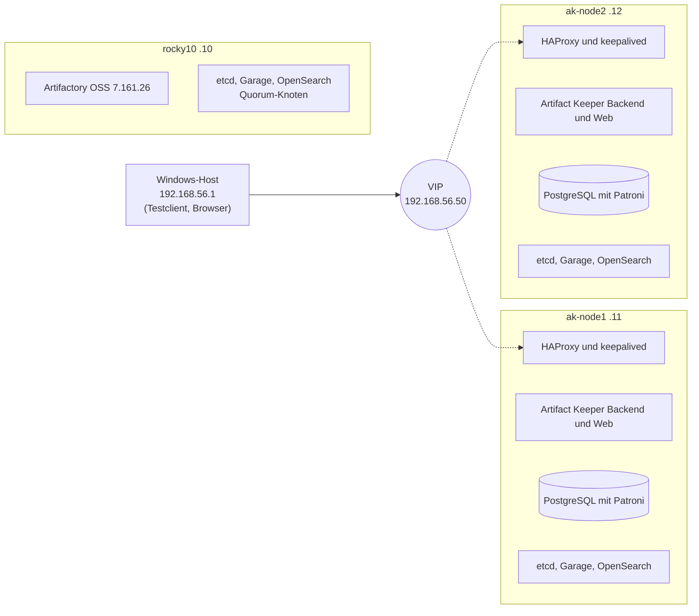

# 01 Laborumgebung

[Übersicht](README.md) | [Weiter: Podman Deployment](02-podman-deployment.md)

## Ziel

Das Labor läuft auf einem einzelnen Windows Rechner und bildet eine realistische Produktionsarchitektur nach. Weil die lizenzierte Instanz für den Test nicht zur Verfügung stand, dienen Artifactory OSS und JFrog Container Registry als Quelle der Migration. Daneben steht ein hochverfügbarer Cluster mit Artifact Keeper und allen Abhängigkeiten.

Dieses Kapitel beschreibt das erste Labor der Evaluierung. Der reproduzierbare Aufbau für jeden Rechner steht in [11](11-nat-netzwerk.md).

## Host

| Eigenschaft | Wert |
|---|---|
| Betriebssystem | Windows 11 Pro 10.0.26200 |
| CPU und RAM | 16 logische Kerne (AMD V), 16 GB |
| Hypervisor | Oracle VirtualBox 7.2.22, installiert per `winget install Oracle.VirtualBox` |
| Gastsystem | Rocky Linux 10.2 Minimal (`Rocky-10.2-x86_64-minimal.iso`, Prüfsumme kontrolliert) |

Windows selbst belegt auf diesem Rechner etwa 5,3 GB. Für VMs bleiben realistisch rund 10 GB. Ein Versuch mit 12 GB RAM für die VMs führte zu starkem Auslagern (386 MB frei, mehr als 800 Page ins pro Sekunde) und verfälschte die Messungen. Ausfalltests auf einem überbuchten Host sind wertlos, deshalb wurde der Speicher reduziert.

## Virtuelle Maschinen

| VM | vCPU | RAM | Disk | Host Only IP | Aufgabe |
|---|---|---|---|---|---|
| `rocky10` | 6 | 5 GB | 80 GB | 192.168.56.10 | Artifactory OSS als Quelle, dritter Knoten für etcd, Garage und OpenSearch, NFS |
| `ak-node1` | 2 | 2,5 GB | 40 GB | 192.168.56.11 | Backend und Web von Artifact Keeper, PostgreSQL mit Patroni, etcd, Garage, OpenSearch, HAProxy, keepalived |
| `ak-node2` | 2 | 2,5 GB | 40 GB | 192.168.56.12 | wie ak-node1 |
| VIP | | | | 192.168.56.50 | keepalived (VRRP) |

Jede VM hat zwei Netzwerkkarten. Die erste hängt am NAT von VirtualBox und dient dem Internetzugang sowie der SSH Weiterleitung auf `127.0.0.1` (Ports 2222, 2223 und 2224). Die zweite hängt im Host Only Netz `192.168.56.0/24`. Darüber läuft der gesamte Clusterverkehr, und der Windows Host erreicht die VMs dort direkt.



## Unbeaufsichtigte Installation

`vm/create-node.ps1` legt eine VM vollständig automatisch an. Grundlage ist die Kickstart Vorlage `vm/rocky10_ks.cfg`. Das Skript richtet den Login per SSH Schlüssel ein, gibt dem Benutzer `rocky` sudo ohne Passwort und setzt eine statische IP im Host Only Netz.

```powershell
powershell -ExecutionPolicy Bypass -File vm\create-node.ps1 -Name ak-node1 -Ip 192.168.56.11 -SshPort 2223 -MemoryMB 2560
```

### Stolperfallen

Alle folgenden Probleme sind im Skript behoben.

| Problem | Ursache | Lösung |
|---|---|---|
| Die VM bleibt im BIOS Modus mit schwarzem Bildschirm stehen | Rocky 10 bootet über GRUB2, VirtualBox passt aber nur `isolinux` an | Firmware auf EFI umstellen (`--firmware efi`) |
| Der Installer startet den Medientest und bricht dabei ab | VirtualBox 7.2 setzt bei Rocky 10 den GRUB Standard auf den zweiten Eintrag und fügt keinen Kickstart Parameter ein | Die erzeugte Datei `Unattended-*-grub.cfg` wird vor dem ersten Start angepasst: `default=0` und `inst.ks=cdrom:/ks.cfg`. Der alte Parameter `ks=` existiert seit RHEL 9 nicht mehr. |
| `openssl` und `podman-compose` fehlen | Minimalinstallation | Installation im Basisskript `lab/ha/00-base.sh` |
| Die VIP antwortet nur manchen Clients | Der DHCP Server von VirtualBox belegt 192.168.56.100 | VIP auf `.50` gelegt, DHCP Server abgeschaltet, Prüfung auf doppelte Adressen per `arping -D` im keepalived Skript |
| Skripte, die per Pipe an `ssh` gehen, scheitern mit `#!/usr/bin/env` oder `$'\r'` | Windows PowerShell 5.1 sendet BOM und CRLF | `vm/run.ps1` überträgt Skripte Base64 kodiert |

## Hilfsskripte auf dem Windows Host

| Skript | Zweck |
|---|---|
| `vm/ssh.ps1 ["befehl"]` | SSH Sitzung auf `rocky10` |
| `vm/run.ps1 -Port <p> -Script <datei> [-ScriptArgs ..]` | lokales Bash Skript auf einer VM ausführen |
| `vm/push.ps1` | `lab/ha` einschließlich `secrets.env` auf alle VMs verteilen |
| `vm/deploy-ha.ps1 [-From x] [-To y]` | HA Cluster schrittweise aufbauen, beliebig oft wiederholbar |
| `vm/ha-watch.ps1` | Live Status des Clusters |
| `vm/failover-all.ps1` | alle Ausfallszenarien unter Last |

`secrets.env` erzeugt `lab/ha/gen-secrets.ps1`. Die Datei ist per `.gitignore` vom Repository ausgeschlossen.

## Zweites Labor für die Automatisierung

Für den Test des Ansible Projekts kamen vier weitere VMs hinzu, die mit demselben Skript entstanden: `ans-ctl` (192.168.56.20, 1,25 GB, nur Ansible) sowie `ans-node1` bis `ans-node3` (192.168.56.21 bis .23). Die VIP liegt dort auf 192.168.56.60. Für den Offline Test wurde bei allen vier VMs die NAT Verbindung getrennt. Einzelheiten stehen in [08](08-ansible.md) und [09](09-offline.md).
