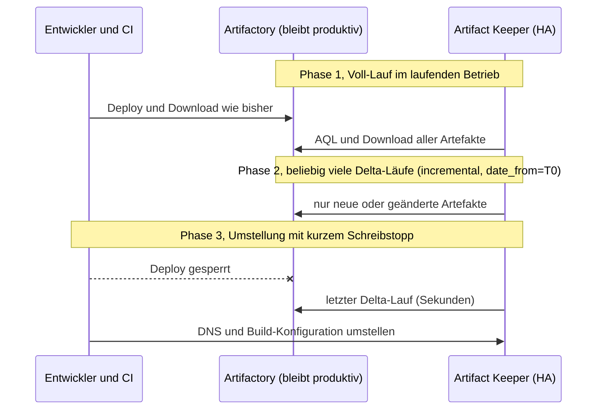

# 03 Migration von JFrog Artifactory zu Artifact Keeper

[Zurück: Podman Deployment](02-podman-deployment.md) | [Übersicht](README.md) | [Weiter: Hochverfügbarkeit](04-hochverfuegbarkeit.md)

## Zusammenfassung

Container Images und Dateien lassen sich im laufenden Betrieb zuverlässig übertragen und mit Delta Läufen nachziehen. Aus JFrog Container Registry kamen 24 von 24 Produktionsimages mit festen Tags identisch an, einschließlich Multi Arch Images. In einem früheren Test mit Artifactory OSS waren 449 von 449 Artefakten bitgenau.

Benutzer, Gruppen und Rechte überträgt Artifact Keeper nicht. Das dafür entwickelte Playbook kopiert ganze Gruppen vollständig. In der Zugriffsmatrix verhielten sich 13 von 14 Fällen gleich. Die Begründung und alle Belege stehen in [12](12-rechte-und-identitaeten.md).

Nicht übertragen werden außerdem Gradle Repositories, Mitglieder virtueller Repositories, Pfadmuster in Rechten, Löschungen, Properties und der Cache von Remote Repositories.

Eine lizenzierte Instanz stand als Quelle nicht zur Verfügung. Geprüft wurde mit JCR und OSS derselben Version 7.161.26. Der Migrator nutzt laut Quelltext AQL und Downloads, die in allen Editionen vorhanden sind. Ein Probelauf gegen die eigene Instanz bleibt trotzdem Teil der Vorbereitung.

## Test mit JFrog Container Registry

Die Quelle läuft auf `ak-ha3`, das Ziel ist der Cluster aus [11](11-nat-netzwerk.md). `playbooks/jcr_seed.yml` lädt die Daten direkt aus den öffentlichen Registries und spielt sie ein. Die Listen stehen in `roles/artifactory_migration/defaults/main.yml` und lassen sich durch eigene Images ersetzen.

| Repository | Typ | Inhalt |
|---|---|---|
| `docker-base` | lokal | alpine (2 Tags, einer Multi Arch), busybox (Multi Arch), debian, python (2 Tags), node, eclipse temurin |
| `docker-prod` | lokal | nginx (2 Tags), httpd, haproxy, traefik, caddy, postgres (2 Tags), redis, memcached, rabbitmq, registry, etcd, prometheus, alertmanager, grafana |
| `docker-hub` | remote | Pull Through auf Docker Hub mit 8 Dateien im Cache |
| `docker-all` | virtuell | fasst die drei Repositories zusammen, nicht im Migrationsumfang |
| `helm-local` | lokal | ingress nginx, prometheus, grafana |
| `generic-tools` | lokal | helm, kubectl |

### Ablauf und Ergebnis

```bash
ansible-playbook -i inventories/natnetwork/hosts.yml playbooks/jcr_seed.yml
ansible-playbook -i inventories/natnetwork/hosts.yml playbooks/migrate.yml --tags artifacts,verify,verify_images
```

| Prüfung | Ergebnis |
|---|---|
| Migrationsjob | 583 Einträge, 313 übertragen, 270 als identisch übersprungen, 0 Fehler, 955 MB |
| Images per Manifest Digest verglichen | 24 von 24 identisch |
| Alle Schichten über die VIP aus dem Ziel geladen, Prüfung je Blob durch `skopeo` | 24 von 24 vollständig |
| Multi Arch: Manifest Liste und alle Plattformen von `alpine:3.21.3` und `busybox:1.37.0` | identisch |
| Helm und Generic per SHA-256 über die nativen Endpunkte | 6 von 6 identisch |
| Repository Typen | `docker-base`, `docker-prod` als lokal, `docker-hub` als remote mit Upstream Adresse |
| Cache von `docker-hub` | **nicht übertragen**, 0 Einträge bei 8 Dateien in der Quelle |

Die vielen übersprungenen Einträge sind Schichten, die mehrere Images teilen. Artifactory legt zudem unter `_uploads` Kopien ab, die der Migrator mit überträgt. Für den Betrieb stört das nicht.

Der Vergleich ist unabhängig vom Migrator: `tasks/verify_images.yml` vergleicht den Digest des Manifests auf beiden Seiten und zieht danach jedes Image komplett aus Artifact Keeper. Sie listet alle Abweichungen auf und schlägt danach fehl.

### Hinweis zur Adresse der Registry

Ein Registry Client holt sein Token von der Adresse, die Artifact Keeper in der Antwort `WWW-Authenticate` nennt. Diese stammt aus `AK_EXTERNAL_URL`. Zeigt sie im Labor auf `localhost:30090`, kann sich ein Client auf einer anderen VM nicht anmelden, auch wenn er die VIP erreicht. In Produktion gehört dort ein DNS Name hin, den alle Clients auflösen. Im Labor öffnet `tasks/token_proxy.yml` den Port vorübergehend auf der ausführenden VM.

### Eigenheiten von JCR

| Beobachtung | Folge |
|---|---|
| Nur Docker, OCI, Helm und Generic | Maven und Gradle Testdaten laufen nur auf OSS (`playbooks/artifactory_seed.yml`). |
| Die Lizenzvereinbarung bleibt zunächst offen (`/artifactory/ui/jcr/eula/required`). Die Anmeldung über die UI API funktionierte trotzdem. | `tasks/eula.yml` nimmt sie nur an, wenn `artifactory_oss_accept_eula` gesetzt ist. |
| Nach dem Passwortwechsel nimmt die REST API das alte Passwort eine Zeit lang weiter an, die UI Anmeldung lehnt es sofort ab. Später kam auch von der REST API 401. | Eine Prüfung direkt nach dem Wechsel wirkt wie ein Fehler. Die genaue Dauer wurde nicht gemessen. |
| Die REST APIs für Benutzer, Gruppen und Rechte antworten mit 400 | Daten werden über die UI API gelesen. |
| Bei rund 3,2 GB RAM auf `ak-ha3` war der Swap fast voll, die UI API hing zeitweise. | Für die Quelle mehr Speicher einplanen. Die Playbooks wiederholen hängende Anfragen. |

## So arbeitet die Migration in Artifact Keeper

* Artifact Keeper bringt eine serverseitige Migrations API unter `/api/v1/migrations` mit. In der Oberfläche liegt sie im Menü Migration.
* Die Quelle wird über AQL aufgelistet und per HTTP geladen. Die Prüfsummen werden gegen die Werte der Quelle geprüft (`verify_checksums`).
* Docker Repositories werden formatgerecht behandelt. Der Worker erkennt Blobs (`sha256__...`) und Manifeste (`manifest.json`, `list.manifest.json`) und trägt sie in die OCI Tabellen ein, damit `docker pull` funktioniert (`classify_oci_source_artifact`, `migration_worker.rs:4402`).
* Der Job läuft auf dem Knoten, der die Startanfrage erhält.
* Es gibt die Jobtypen `assessment`, `full` und `incremental`. Zu den Optionen zählen `dry_run`, `include_repos`, `exclude_repos`, `exclude_paths`, `repo_mappings`, `conflict_resolution`, `concurrent_transfers`, `throttle_delay_ms`, `date_from` und `date_to`.
* `incremental` ist ein Zeitfilter auf die AQL Abfrage mit Duplikaterkennung über SHA-256. Identische Dateien werden übersprungen, geänderte erneut übertragen.
* Eine Quelle in einem privaten Netz muss für den SSRF Schutz freigegeben sein: `AK_SSRF_ALLOW_PRIVATE_CIDRS=<adresse-der-quelle>`.
* `MIGRATION_ENCRYPTION_KEY` verschlüsselt die gespeicherten Zugangsdaten der Quelle. Der Wert muss auf allen Knoten gleich sein.

## Ablauf einer Migration im laufenden Betrieb



## Test mit Artifactory OSS und Änderungen während der Migration

Dieser ältere Test prüfte das Verhalten unter laufenden Änderungen. Das Skript `lab/migration/migrate-live.sh` migrierte in den Cluster, während ein Testschreiber jede Sekunde eine neue Datei in die Quelle lud. Eine bestehende Datei wurde überschrieben und danach eine gelöscht.

| Schritt | Ergebnis |
|---|---|
| Verbindungstest | erfolgreich, erkannt wurde `Artifactory 7.161.26 / Artifactory OSS` |
| Repositories der Quelle | alle 7 aufgelistet, auch remote und virtuell |
| Assessment | lieferte sofort `0 Artefakte`. Das Ergebnis entsteht asynchron und ist erst nach Abschluss aussagekräftig. |
| Dry Run | 355 Einträge mit 574,5 MB erkannt, nichts geschrieben |
| Voll Lauf | 365 Einträge mit 574 MB in 99 Sekunden, ein Fehler beim Repository `gradle-plugins`. Parallel kamen 99 neue Dateien hinzu. |
| Delta Lauf (`incremental`, `date_from=T0`) | 101 Einträge in 20 Sekunden, 87 übertragen, 14 als identisch übersprungen |
| Repositories vom Typ remote und virtuell | als `remote` und `virtual` angelegt, Upstream Adresse übernommen |

`lab/migration/verify.sh` lud jede Datei der Quelle über die VIP aus Artifact Keeper und verglich die SHA-256 Prüfsumme.

| Ergebnis | Anzahl | Erklärung |
|---|---|---|
| identisch | 449 | einschließlich der Datei mit 512 MB, der Dateien aus dem laufenden Upload und der geänderten Datei |
| abweichend | 6 | ausschließlich `maven-metadata.xml`, weil Artifact Keeper die Maven Metadaten selbst erzeugt |
| fehlt | 3 | Repository `gradle-plugins`, der Typ Gradle wird nicht unterstützt |
| ausgenommen | 1 | `example-repo-local`, bewusst nicht im Umfang |

**Korrektur zum Remote Cache.** Frühere Fassungen dieses Berichts nannten den Cache von Remote Repositories als übertragen. Das war falsch. Die Option `include_cached_remote` wird nur im Modell definiert und nirgends ausgewertet (`backend/src/models/migration.rs:135`), und in der Tabelle `migration_items` fehlen solche Einträge. Der Vergleich fiel trotzdem positiv aus, weil Artifact Keeper die Dateien beim Abruf über das Remote Repository neu vom Upstream holte. Die genaue Ursache im Worker wurde nicht weiter untersucht. Für den Betrieb heißt das: Nach der Umstellung baut sich der Cache neu auf, solange der Upstream erreichbar ist. Ein Image, das nur noch im Cache liegt, geht verloren. Solche Images gehören vorher in ein lokales Repository.

Weitere Prüfungen:

| Prüfung | Ergebnis |
|---|---|
| Datei in der Quelle geändert | Der neue Inhalt kam an, weil der Delta Lauf die abweichende Prüfsumme erkennt. |
| Datei in der Quelle gelöscht | Sie bleibt im Ziel bestehen. Löschungen werden nie übertragen. |
| virtuelles Repository `maven-all` | ohne Mitglieder angelegt, liefert deshalb 404 |
| Properties (`team`, `env`, `build.number`) | gehen verloren, weder als Metadaten noch als Labels auffindbar |

## Lücken der eingebauten Migration

| Thema | Beobachtung | Abhilfe |
|---|---|---|
| Benutzer, Gruppen, Rechte | Die Optionen werden angenommen, aber nie ausgeführt, Belege in [12](12-rechte-und-identitaeten.md). | `migrate.yml --tags security` oder Identitätsanbieter |
| Passwörter und Tokens | nicht übertragbar | Einmalpasswort, Identitätsanbieter, neue Tokens für Pipelines |
| Cache von Remote Repositories | wird nicht übertragen | wichtige Images vorab in ein lokales Repository kopieren |
| Gradle Repositories | `Package type 'gradle' is not supported for migration` | vorher ein Maven Repository gleichen Namens anlegen oder `repo_mappings` nutzen und von Hand hochladen |
| virtuelle Repositories | Die Mitglieder fehlen. | nach der Migration setzen |
| Löschungen | werden nicht übertragen | nach der Umstellung durch Abgleich der Manifeste bereinigen |
| Properties | gehen verloren | Prozesse prüfen, die Properties auswerten |
| Pfadmuster in Rechten | gibt es im Ziel nicht | Repositories fachlich schneiden |
| REST API für Downloads | bei S3 auf 30 Anfragen pro Minute und Adresse begrenzt (`RATE_LIMIT_PRESIGN_PER_MIN`) | Clients und Prüfungen über die nativen Endpunkte, dort gilt das Limit nicht |

## Migrationswege im Vergleich

Die Wege wurden auf dem Einzelknoten aus [10](10-einzelknoten.md) und im Cluster aus [11](11-nat-netzwerk.md) geprüft.

| Weg | Was übertragen wird | Ergebnis im Test | Einsatz |
|---|---|---|---|
| Migrations API, automatisiert mit `playbooks/migrate.yml` | Repositories und Artefakte, wiederholbar als Delta | 24 von 24 Images aus JCR, 58 von 58 Dateien aus OSS | Hauptweg |
| Assistent in der Weboberfläche | dasselbe wie die API, die Oberfläche nutzt sie | 5 von 5 Dateien bitgenau. Die Häkchen für Benutzer, Gruppen und Rechte sind wirkungslos. | einzelne Repositories und Nachzügler |
| Kommandozeile `ak migrate` (CLI 1.2.0) | Artefakte zwischen zwei Instanzen von Artifact Keeper | 5 von 5 zwischen zwei Instanzen. Mit Artifactory als Quelle scheitert der Aufruf, weil das Werkzeug dort die API von Artifact Keeper erwartet. | Umzug zwischen Installationen |
| Remote Repository mit Artifactory als Upstream (Pull Through) | nur angefragte Artefakte | mit Basic Auth am Upstream bitgenau geholt und im Cache abgelegt | schrittweise Umstellung |
| Manuell mit nativen Clients, etwa `mvn deploy:deploy-file` oder `skopeo copy` | einzelne Artefakte | bitgenau | Sonderfälle wie Gradle |

Abweichungen zwischen Dokumentation und Verhalten sind in [12](12-rechte-und-identitaeten.md) zusammengefasst. Hinzu kommt ein Punkt im Betrieb: Ein inkrementeller Lauf ohne neue Dateien endet mit dem Status `failed`, sobald ein nicht migrierbares Repository wie Gradle in der Auswahl steht. Das Playbook nimmt solche Repositories deshalb vorab heraus und meldet sie.

## Migration mit Ansible

```bash
ansible-playbook -i inventories/<umgebung>/hosts.yml playbooks/migrate.yml --tags artifacts      # Artefakte, erster Lauf voll, danach Delta
ansible-playbook -i inventories/<umgebung>/hosts.yml playbooks/migrate.yml --tags verify         # Dateien per SHA-256
ansible-playbook -i inventories/<umgebung>/hosts.yml playbooks/migrate.yml --tags verify_images  # Images per Digest und vollständigem Pull
ansible-playbook -i inventories/<umgebung>/hosts.yml playbooks/migrate.yml --tags security       # Benutzer, Gruppen, Rechte samt Vergleich
ansible-playbook -i inventories/<umgebung>/hosts.yml playbooks/migrate.yml --tags verify_access  # Zugriffsmatrix mit echten Benutzern
```

Die Tags `verify_images` und `verify_access` laufen nur, wenn sie ausdrücklich genannt sind, weil sie die Container Testdaten voraussetzen. Alle Schritte sind wiederholbar.

Die UI API von Artifactory reagiert unzuverlässig. Der Frontend Dienst versucht jede Sekunde vergeblich, Lizenzinformationen abzurufen, und lässt dabei gelegentlich Anfragen hängen. Die Playbooks wiederholen solche Anfragen und werten `existiert bereits` als Erfolg.

## Empfohlenes Vorgehen in der Produktion

1. Bestand aufnehmen: Repositories, Paketformate, Permission Targets mit Pfadmustern, Rechte auf Builds und Release Bundles, Pipelines mit Tokens, Abhängigkeiten von Properties.
2. Entscheiden, ob ein Identitätsanbieter führt. Der Ablauf steht in [12](12-rechte-und-identitaeten.md) und muss vor dem Anlegen von Benutzern feststehen.
3. Das Rechtekonzept auf Repositories übertragen und allgemeine Leserechte ausdrücklich vergeben.
4. Gradle Repositories vorab als Maven Repositories anlegen und virtuelle Repositories nach dem Voll Lauf konfigurieren. Images, die nur im Remote Cache liegen, vorab sichern.
5. `MIGRATION_ENCRYPTION_KEY` setzen, die Quelle freigeben, `AK_EXTERNAL_URL` auf einen DNS Namen setzen.
6. Dry Run, Voll Lauf im Betrieb, tägliche Delta Läufe, zuletzt die Umstellung mit Schreibstopp und einem letzten Delta Lauf.
7. Ergebnis per Digest und SHA-256 prüfen, Zugriffsmatrix mit eigenen Fällen ausführen, Löschungen nachziehen.
8. Artifactory für den Rückfall bis zum Ende der Lizenzlaufzeit nur lesend weiterbetreiben.
