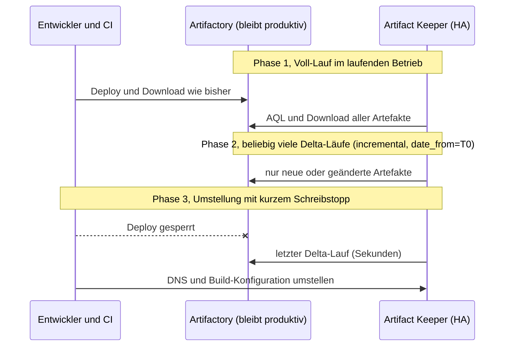

# 03 Migration von Artifactory zu Artifact Keeper

[Zurück: Podman-Deployment](02-podman-deployment.md) | [Übersicht](README.md) | [Weiter: Hochverfügbarkeit](04-hochverfuegbarkeit.md)

## Zusammenfassung

Artefakte lassen sich zuverlässig migrieren und im laufenden Betrieb mit Delta-Läufen nachziehen. Im Test waren 449 von 449 Artefakten bitgenau identisch (SHA-256), auch die Dateien, die während der Migration neu hochgeladen wurden. User, Gruppen und Berechtigungen migriert Artifact Keeper 1.11.11 trotz anderslautender Dokumentation nicht. Dafür ist ein eigenes Skript nötig, das im Labor entstanden und getestet ist. Gradle-Repositories, die Mitglieder virtueller Repositories, Pfadmuster in Berechtigungen und Löschungen werden ebenfalls nicht übertragen.

## Ausgangsdaten in Artifactory OSS 7.161.26

| Repository | Typ | Inhalt |
|---|---|---|
| `maven-releases` | lokal, Maven | 12 GAVs mit POM, JAR und Sources, 40 Dateien |
| `maven-snapshots` | lokal, Maven | 2 Snapshot-Builds |
| `gradle-plugins` | lokal, Gradle | 1 Plugin |
| `generic-files` | lokal, Generic | 300 Dateien mit Properties (`team`, `build.number`, `env`), fünf Dateien mit 5 bis 17 MB, eine Datei mit 512 MB |
| `maven-central` | remote, Maven | 4 Artefakte im Cache |
| `maven-all` | virtuell, Maven | fasst releases, snapshots und central zusammen |

Für die Berechtigungen gibt es die User `alice` und `bob` in der Gruppe `developers` sowie `carol` in der Gruppe `release-managers`. Dazu kommen die Permission Targets `dev-snapshots` mit einer User-Regel, `dev-write` für eine Gruppe mit dem Ausschluss `isos/**` und `release-deploy`.

Befüllt wurde Artifactory mit `lab/artifactory/seed.sh` und den Skripten `seed-security*.sh`. Insgesamt sind es 360 Dateien mit 576 MB.

## So funktioniert die Migration in Artifact Keeper

* Artifact Keeper bringt eine serverseitige Migrations-API unter `/api/v1/migrations` mit. In der Oberfläche liegt sie unter Administration, Migration.
* Die Quelle wird über AQL aufgelistet und per HTTP geladen. Die Prüfsummen werden gegen die von Artifactory gemeldeten Werte geprüft (`verify_checksums`).
* Der Job läuft auf dem Knoten, der die Startanfrage erhält. Im HA-Cluster ist das eines der beiden Backends.
* Es gibt die Job-Typen `assessment`, `full` und `incremental`. Zu den Optionen zählen `dry_run`, `include_repos`, `exclude_repos`, `exclude_paths`, `repo_mappings` zum Umbenennen, `include_cached_remote`, `conflict_resolution` mit `skip`, `overwrite` oder `rename`, `concurrent_transfers`, `throttle_delay_ms` sowie `date_from` und `date_to`.
* Der Typ `incremental` ist ein Zeitfilter auf die AQL-Abfrage (`date_from` und `date_to`) kombiniert mit einer Duplikaterkennung über SHA-256. Identische Dateien werden übersprungen, geänderte erneut übertragen.
* Liegt die Quelle in einem privaten Netz, muss sie für den SSRF-Schutz freigegeben werden: `AK_SSRF_ALLOW_PRIVATE_CIDRS=<ip-der-quelle>`. Diese gezielte Freigabe ist der pauschalen Variable `UPSTREAM_ALLOW_PRIVATE_IPS` vorzuziehen.
* `MIGRATION_ENCRYPTION_KEY` verschlüsselt die gespeicherten Zugangsdaten der Quelle. Der Wert muss gesetzt und auf allen Knoten gleich sein, sonst greift ein unsicherer Ersatzschlüssel für Entwicklungszwecke.

## Ablauf einer Live-Migration



## Testlauf im Labor

Das Skript `lab/migration/migrate-live.sh` migrierte in den HA-Cluster über die VIP. Während des Voll-Laufs lud ein Testschreiber jede Sekunde eine neue Datei in Artifactory. Eine bestehende Datei wurde überschrieben und danach eine gelöscht.

| Schritt | Ergebnis |
|---|---|
| Verbindungstest | erfolgreich, erkannt wurde `Artifactory 7.161.26 / Artifactory OSS` |
| Repositories der Quelle | alle 7 aufgelistet, auch remote und virtuell |
| Assessment | lieferte sofort `0 Artefakte`. Das Ergebnis entsteht asynchron und ist erst nach Abschluss aussagekräftig. |
| Dry-Run | 355 Einträge mit 574,5 MB erkannt, nichts geschrieben |
| Voll-Lauf | 365 Einträge mit 574 MB in 99 Sekunden, ein Fehler beim Repository `gradle-plugins`. Parallel kamen 99 neue Dateien in der Quelle hinzu. |
| Delta-Lauf (`incremental`, `date_from=T0`) | 101 Einträge in 20 Sekunden. 87 neue oder geänderte Dateien wurden übertragen, 14 als identisch übersprungen. |
| Repositories vom Typ remote und virtuell | als `remote` und `virtual` angelegt, Upstream-URL übernommen |
| Cache der Remote-Repositories (`include_cached_remote`) | 4 Dateien übernommen |

### Verifikation

`lab/migration/verify.sh` lud jede Datei der Quelle laut AQL-Manifest (459 Dateien) über die VIP aus Artifact Keeper und verglich die SHA-256-Prüfsumme.

| Ergebnis | Anzahl | Erklärung |
|---|---|---|
| identisch | 449 | alle Artefakte einschließlich der Datei mit 512 MB, der Live-Uploads, der geänderten Datei und des Remote-Caches |
| abweichend | 6 | ausschließlich `maven-metadata.xml`, weil Artifact Keeper die Maven-Metadaten selbst erzeugt |
| fehlt | 3 | Repository `gradle-plugins`, der Typ Gradle wird nicht unterstützt |
| ausgenommen | 1 | `example-repo-local`, bewusst nicht im Umfang |

Weitere Prüfungen:

| Prüfung | Ergebnis |
|---|---|
| Datei in der Quelle geändert | Der neue Inhalt kam in Artifact Keeper an, weil der Delta-Lauf die abweichende Prüfsumme erkennt. |
| Datei in der Quelle gelöscht | Sie bleibt in Artifact Keeper bestehen. Löschungen werden nie übertragen. |
| virtuelles Repository `maven-all` | Es wurde ohne Mitglieder angelegt und liefert deshalb 404. Die Mitglieder müssen von Hand gesetzt werden. |
| Properties (`team`, `env`, `build.number`) | Über die API ließ sich nicht prüfen, ob sie in Artifact Keeper angekommen sind. |

## Lücken der eingebauten Migration

| Thema | Beobachtung | Abhilfe |
|---|---|---|
| User, Gruppen, Berechtigungen | Die Optionen `include_users`, `include_groups` und `include_permissions` werden angenommen, aber nie ausgeführt. Die Funktionen `migrate_users`, `migrate_groups` und `migrate_permissions` im Worker ruft niemand auf, das Kommandozeilenwerkzeug enthält `// TODO: Create user in Artifact Keeper`. Zusätzlich sperrt Artifactory OSS die zugehörigen APIs. | eigenes Skript `lab/migration/migrate-security.sh` (siehe unten) oder besser Identitäten aus LDAP oder OIDC |
| Passwörter | grundsätzlich nicht migrierbar, weil sich keine Hashes exportieren lassen | Einmalpasswort mit Pflicht zum Wechsel oder SSO |
| Gradle-Repositories | `Package type 'gradle' is not supported for migration` | vorher ein Maven-Repository gleichen Namens in Artifact Keeper anlegen oder `repo_mappings` nutzen und von Hand hochladen |
| virtuelle Repositories | Die Mitglieder fehlen. | Mitglieder nach der Migration setzen |
| Löschungen | werden nicht übertragen | nach der Umstellung durch Abgleich der Manifeste bereinigen |
| Pfadmuster in Berechtigungen | Regeln in Artifact Keeper kennen nur Repository und Aktion, optional mit IP-Bedingung. | Rechte auf Ebene der Repositories neu zuschneiden |
| REST-API für Downloads | bei S3 auf 30 Anfragen pro Minute und IP begrenzt (`RATE_LIMIT_PRESIGN_PER_MIN`) | Clients und Verifikation über die nativen Endpunkte (`/maven/`, `/general/`), dort gilt kein Limit |

## Migration der Berechtigungen mit eigenem Skript

`lab/migration/migrate-security.sh` liest User, Gruppen und Berechtigungen aus Artifactory und legt sie über die API von Artifact Keeper an. Die Rechte werden so abgebildet: `READ` wird `read`, `WRITE` und `ANNOTATE` werden `write`, `DELETE` wird `delete`, `MANAGE` wird `admin`. Regeln mit Include- oder Exclude-Mustern lässt das Skript im Standardmodus `strict` weg. Im Modus `broad` vergibt es sie für das ganze Repository, was unsicher ist.

| Objekt | Quelle | Artifact Keeper |
|---|---|---|
| User | 3 | 3, jeweils mit Einmalpasswort und `must_change_password=true` |
| Gruppen mit Mitgliedern | 2 | 2, Mitglieder korrekt |
| Regeln | 3 Permission Targets | 5 Regeln. Eine wurde wegen des Pfadmusters bewusst weggelassen, eine entfällt mit dem Gradle-Repository. |

Die Durchsetzung der Rechte prüfte `lab/migration/test-permissions.sh` über die nativen Endpunkte.

| Fall | Erwartung wie in Artifactory | Antwort von Artifact Keeper | Bewertung |
|---|---|---|---|
| bob schreibt in `maven-snapshots` | erlaubt | 201 | wie erwartet |
| bob schreibt in `maven-releases` | verboten | 403 | wie erwartet |
| bob liest `maven-releases` | erlaubt | 200 | wie erwartet |
| bob schreibt in `generic-files/isos/` | verboten | 403 | wie erwartet |
| bob schreibt in `generic-files/team/` | erlaubt | 403 | strenger als vorher, weil die Regel mit Pfadmuster weggelassen wurde |
| carol schreibt in `maven-releases` | erlaubt | 201 | wie erwartet |
| carol schreibt in `generic-files` | verboten | 403 | wie erwartet |
| carol liest `generic-files` | erlaubt durch die Standardgruppe `readers` mit „Anything“ | 404 | strenger als vorher. Ein allgemeines Leserecht muss in Artifact Keeper bewusst vergeben werden. |
| alice schreibt in `maven-snapshots` | erlaubt | 201 | wie erwartet |
| anonymer Zugriff auf `maven-releases` | verboten | 401 | wie erwartet |

Fehlt das Leserecht, antwortet Artifact Keeper mit 404 statt 403. So lässt sich nicht erkennen, ob ein Artefakt überhaupt existiert.

## Migrationswege im Vergleich

Die Dokumentation von Artifact Keeper beschreibt mehrere Wege aus Artifactory heraus. Alle wurden auf dem Einzelknoten aus [10](10-einzelknoten.md) praktisch geprüft, mit Artifactory OSS 7.161.26 als Quelle.

| Weg | Was übertragen wird | Ergebnis im Test | Einsatz |
|---|---|---|---|
| Migrations-API (`/api/v1/migrations`), automatisiert mit `playbooks/migrate.yml` | Repositories, Artefakte, Remote-Cache, wiederholbar als Delta | 58 von 58 Dateien bitgenau, Delta-Lauf mit einer neuen Datei ebenfalls korrekt | Hauptweg für die Umstellung |
| Assistent in der Weboberfläche unter Migration | dasselbe wie die API, die Oberfläche nutzt sie direkt | Verbindung anlegen, Repositories aus der Quelle auswählen, Job anlegen und starten funktioniert. 5 von 5 Dateien bitgenau. | gut für einzelne Repositories und Nachzügler ohne Skript |
| Kommandozeile `ak migrate` (artifact-keeper-cli 1.2.0) | Artefakte zwischen zwei Instanzen von Artifact Keeper | Zwischen zwei Artifact-Keeper-Repositories 5 von 5 bitgenau. Mit Artifactory als Quelle scheitert der Aufruf, weil das Werkzeug dort die API von Artifact Keeper erwartet. | nur für Umzüge zwischen Artifact-Keeper-Installationen |
| Remote-Repository in Artifact Keeper mit Artifactory als Upstream (Pull-Through) | nur Artefakte, die ein Client tatsächlich anfragt | Artefakt mit Basic Auth am Upstream bitgenau geholt und im Cache abgelegt | schrittweise Umstellung, Clients zeigen sofort auf Artifact Keeper |
| Manuell mit nativen Clients, etwa `mvn dependency:get` und `mvn deploy:deploy-file` | einzelne Artefakte | bitgenau | Sonderfälle wie Gradle-Repositories |

Mehrere Punkte aus der Dokumentation von Artifact Keeper stimmen nicht mit dem Verhalten überein:

* Im Assistenten sind die Häkchen für Users, Groups und Permissions standardmäßig gesetzt und werden im Job auch so gespeichert. Übertragen werden Benutzer, Gruppen und Rechte trotzdem nicht. Ein in Artifactory neu angelegter Benutzer `dave` und eine Gruppe `qa` kamen nach einem Job mit diesen Häkchen nicht an.
* Die Seite zur Migration aus Artifactory nennt einen Assistenten in der Oberfläche nicht. Er existiert aber unter dem Menüpunkt Migration.
* Die API-Referenz beschreibt `POST /api/v1/migrations` mit `source_url`, `source_username` und `repositories`. Diese Form gibt es nicht mehr, die API verlangt `source_connection_id` und antwortet sonst mit 422.
* Properties wie `team`, `build.number` oder `env` gehen verloren. Weder als Metadaten noch als Labels sind sie in Artifact Keeper zu finden.
* Ein inkrementeller Lauf ohne neue Dateien endet mit dem Status „failed“, sobald ein nicht migrierbares Repository wie Gradle in der Auswahl steht. Das Playbook nimmt solche Repositories deshalb vorab heraus und meldet sie.

Für Docker-Images wurde kein Weg getestet, weil Artifactory OSS keine Docker-Repositories kennt. Die Doku nennt dafür `docker pull`, `docker tag` und `docker push`.

## Migration mit Ansible

`playbooks/artifactory_seed.yml` füllt ein Test-Artifactory, `playbooks/migrate.yml` führt die Migration in drei Schritten aus, die sich auch einzeln per Tag starten lassen:

```bash
ansible-playbook -i inventories/<umgebung>/hosts.yml playbooks/migrate.yml                     # alles
ansible-playbook -i inventories/<umgebung>/hosts.yml playbooks/migrate.yml --tags artifacts     # nur Artefakte
ansible-playbook -i inventories/<umgebung>/hosts.yml playbooks/migrate.yml --tags verify        # Prüfung per SHA-256
ansible-playbook -i inventories/<umgebung>/hosts.yml playbooks/migrate.yml --tags security      # Benutzer, Gruppen, Rechte
```

Der erste Lauf ist eine Vollmigration, jeder weitere ein inkrementeller Lauf ab dem Start des letzten erfolgreichen Jobs. Die Verifikation lädt jede Datei der Quelle über die nativen Endpunkte aus Artifact Keeper und vergleicht die Prüfsumme. Die Rechte-Migration legt Benutzer mit Einmalpasswort an (Datei nur für root lesbar), überträgt Gruppen samt Mitgliedern und erzeugt je Repository und Benutzer oder Gruppe eine Regel. Regeln mit Pfadmustern lässt sie im Standardmodus `strict` weg und meldet sie. Alle drei Schritte sind wiederholbar, ein zweiter Lauf legt nichts doppelt an.

Die UI-API von Artifactory OSS reagiert unzuverlässig. Der Frontend-Dienst versucht jede Sekunde vergeblich, Lizenzinformationen abzurufen, die es in OSS nicht gibt, und lässt dabei gelegentlich Anfragen hängen. Die Playbooks wiederholen solche Anfragen deshalb und werten „existiert bereits“ als Erfolg.

## Empfohlenes Vorgehen in der Produktion

1. Identitäten vorher auf LDAP oder OIDC umstellen (in Artifact Keeper über `LDAP_*` oder `OIDC_*`) und die Zuordnung der Gruppen festlegen.
2. Das Rechtekonzept auf Repositories übertragen, ohne Pfadmuster, und allgemeine Leserechte ausdrücklich vergeben.
3. Gradle-Repositories vorab als Maven-Repositories anlegen und virtuelle Repositories nach dem Voll-Lauf konfigurieren.
4. `MIGRATION_ENCRYPTION_KEY` setzen und die Quelle über `AK_SSRF_ALLOW_PRIVATE_CIDRS` freigeben.
5. Erst Assessment und Dry-Run, dann der Voll-Lauf im Betrieb, danach tägliche Delta-Läufe und zuletzt die Umstellung mit Schreibstopp und einem letzten Delta-Lauf.
6. Das Ergebnis über einen Abgleich der Manifeste per SHA-256 prüfen und Löschungen nachziehen.
7. Artifactory für den Rückfall noch einige Wochen nur lesend weiterbetreiben.
