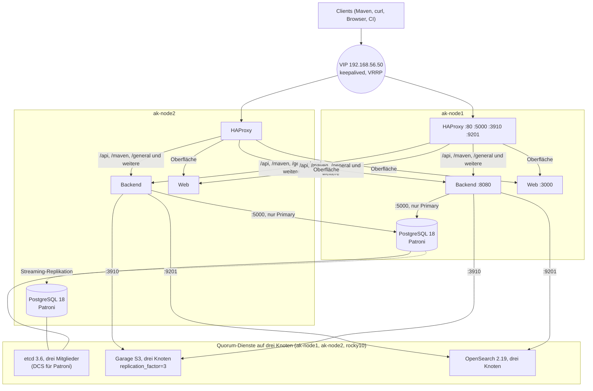

# 04 Hochverfügbarkeit

[Zurück: Migration](03-migration.md) | [Übersicht](README.md) | [Weiter: Testprotokoll](05-testprotokoll.md)

## Lässt sich Artifact Keeper hochverfügbar betreiben?

Ja, und zwar aktiv/aktiv. Das Backend hält keinen eigenen Zustand. Metadaten liegen in PostgreSQL, Artefakte in einem Objektspeicher (S3, GCS, Azure) oder auf einem gemeinsamen Dateisystem, die Suche in OpenSearch. Tokens werden mit einem gemeinsamen `JWT_SECRET` signiert, Sticky Sessions sind daher nicht nötig. Hintergrundjobs wie RPM-Retention, LDAP-Abgleich oder das Füllen des Pull-Through-Caches stimmen sich über PostgreSQL ab (Leases und Advisory Locks). Das offizielle Helm-Chart sieht für die Produktion mindestens drei Replikas vor.

Für seine Abhängigkeiten bringt Artifact Keeper keine Hochverfügbarkeit mit. PostgreSQL, Objektspeicher und OpenSearch müssen selbst ausfallsicher sein, und darin liegt der eigentliche Aufwand. Zum Vergleich: Bei Artifactory setzt Hochverfügbarkeit eine Enterprise-Lizenz voraus, OSS und Pro bieten sie nicht.

## Architektur im Labor



| Schicht | Komponente | Mechanismus | Verkraftet |
|---|---|---|---|
| Einstieg | keepalived 2.2.8 (VRRP unicast) | Die VIP wandert, `track_process haproxy`, `nopreempt` | Ausfall eines Knotens oder von HAProxy |
| Load Balancer | HAProxy 3.0.5 auf jedem Knoten | Health-Checks auf `/readyz` (API), `/` (Web), Patroni `/primary` (Datenbank), Garage `/health` und OpenSearch `/_cluster/health` | Ausfall eines Backends |
| Anwendung | Backend und Web von Artifact Keeper 1.11.11, rootless Podman | aktiv/aktiv, Round Robin | Ausfall eines Knotens |
| Datenbank | PostgreSQL 18.6 mit Patroni 4.1.5 (PGDG) | Streaming-Replikation, automatischer Failover, `pg_rewind` | Ausfall des Primary |
| DCS | etcd 3.6.16 mit drei Mitgliedern im Container | Raft, Quorum zwei von drei | Ausfall eines Knotens |
| Objektspeicher | Garage 2.5.0 auf drei Knoten | dreifache Replikation, Quorum zwei von drei | Ausfall eines Knotens |
| Suche | OpenSearch 2.19.6 auf drei Knoten | Replikas, Wahl des Cluster-Managers | Ausfall eines Knotens |

### Warum drei Knoten?

Systeme mit Quorum wie etcd, Garage und OpenSearch brauchen eine ungerade Zahl von Stimmen. Andernfalls kann bei einer Netztrennung keine Hälfte weiterarbeiten, oder es droht ein Split-Brain. Der dritte Knoten `rocky10` trägt im Labor nur die Quorum-Dienste. In der Produktion eignen sich drei gleichwertige Knoten oder ein kleiner dritter Knoten als Witness.

### Warum Garage statt MinIO?

MinIO veröffentlicht seit Ende 2025 keine Community-Images mehr. `docker.io/minio/minio` liefert 404, verfügbar sind nur noch der Quellcode und das kommerzielle AIStor. Für einen Neuaufbau im Jahr 2026 ist das keine tragfähige Grundlage. Garage steht unter AGPL, wird aktiv gepflegt, ist für kleine selbst betriebene Cluster gebaut und braucht etwa 40 MB RAM. Im Unternehmensumfeld kommen auch Ceph RGW, NetApp StorageGRID oder S3 aus der Cloud in Frage.

### Gemeinsamer Speicher: S3 oder NFS?

| | S3 (Garage, Ceph, Cloud) | NFS |
|---|---|---|
| Konfiguration | `STORAGE_BACKEND=s3` und die Variablen `S3_*` | `STORAGE_BACKEND=filesystem`, `STORAGE_PATH` auf dem NFS-Mount, auf allen Knoten gleich |
| Ausfallsicherheit | eingebaut durch Replikation und Quorum | nur so gut wie das NAS. Ohne hochverfügbares NAS ist es ein Single Point of Failure. |
| Betrieb | eigener Cluster oder Cloud | vorhandene NAS-Infrastruktur nutzbar |
| Besonderheit | Die REST-API für Downloads ist auf 30 Anfragen pro Minute und IP begrenzt, die nativen Endpunkte nicht. | Bei rootless Podman muss die UID-Zuordnung auf allen Knoten gleich sein, dazu das SELinux-Boolean `virt_use_nfs`. |
| Empfehlung | Standard für mehrere Replikas | nur, wenn ein hochverfügbares NAS vorhanden ist |

## Konfiguration in Auszügen

### keepalived (`lab/ha/50-haproxy-keepalived.sh`)

```text
vrrp_track_process track_haproxy { process haproxy  weight -50  delay 1 }
vrrp_instance VI_AK {
    state BACKUP
    nopreempt                     # kein zweiter Wechsel, wenn der alte Knoten zurückkommt
    interface enp0s8
    virtual_router_id 56
    priority 110                  # ak-node2: 100
    unicast_src_ip 192.168.56.11
    unicast_peer { 192.168.56.12 }
    virtual_ipaddress { 192.168.56.50/24 dev enp0s8 label enp0s8:vip }
    track_process { track_haproxy }
}
```

Die Firewall muss VRRP zulassen (`firewall-cmd --add-rich-rule='rule protocol value="vrrp" accept'`). Bevor eine VIP gesetzt wird, sollte man prüfen, ob die Adresse frei ist (`arping -D`). Im Labor kollidierte die erste Wahl `.100` mit dem DHCP-Server von VirtualBox.

### HAProxy (`lab/ha/haproxy.cfg.tpl`)

```text
frontend ak
    bind *:80
    option forwardfor
    http-response set-header X-Served-By %[hostname]   # Diagnose: welcher Knoten hält die VIP
    http-response set-header X-AK-Backend %s           # Diagnose: welches Backend hat geantwortet
    acl is_backend path_beg /api/ /v2 /health /livez /readyz /metrics /maven/ /npm/ /pypi/ /general/ ...
    use_backend ak_api if is_backend
    default_backend ak_web

backend ak_api
    option httpchk GET /readyz
    default-server inter 2s fall 2 rise 2 slowstart 10s
    server ak-node1 192.168.56.11:8080 check
    server ak-node2 192.168.56.12:8080 check

listen postgres
    bind *:5000
    mode tcp
    option httpchk OPTIONS /primary          # Patroni REST-API: 200 nur auf dem Primary
    default-server inter 2s fall 2 rise 2 on-marked-down shutdown-sessions
    server ak-node1 192.168.56.11:5432 check port 8008
    server ak-node2 192.168.56.12:5432 check port 8008
```

Für SELinux ist `setsebool -P haproxy_connect_any 1` nötig.

### Artifact Keeper (`lab/ha/60-ak-node.sh`, `lab/ha/ak-node.compose.yaml`)

Für mehrere Replikas sind die folgenden Werte Pflicht, und zwar auf allen Knoten identisch.

| Variable | Zweck |
|---|---|
| `JWT_SECRET` | Signatur der Tokens. Mit unterschiedlichen Werten gilt ein Login nur auf einem Knoten. |
| `MIGRATION_ENCRYPTION_KEY`, `SSO_ENCRYPTION_KEY`, `AK_WEBHOOK_SECRET_KEY` | Verschlüsselte Felder in der Datenbank müssen auf jedem Knoten lesbar sein. Jeder Wert ist Base64 von genau 32 Byte. |
| `DATABASE_URL=...@<knoten-ip>:5000/...?sslmode=require` | Die Datenbank wird immer über den lokalen HAProxy und damit über den aktuellen Primary angesprochen. |
| `STORAGE_BACKEND=s3`, `S3_ENDPOINT=http://<knoten-ip>:3910` | gemeinsamer Objektspeicher |
| `OPENSEARCH_URL=http://<knoten-ip>:9201` | OpenSearch-Cluster |
| `PROXY_SINGLEFLIGHT_ADVISORY_LOCKS_ENABLED=true` | Der Cache der Remote-Repositories wird clusterweit nur einmal gefüllt. |
| `DATABASE_MAX_CONNECTIONS=20` | Replikas mal Pool plus Reserve muss unter `max_connections` (200) bleiben. |
| `RATE_LIMIT_TRUSTED_PROXY_CIDRS=192.168.56.0/24`, `XFF_TRUSTED_FOR_AUTHZ=true` | echte Client-IP hinter HAProxy |
| `AK_EXTERNAL_URL=http://192.168.56.50` | öffentliche URL für Weiterleitungen und SSO |

## Aufbau

```powershell
powershell -ExecutionPolicy Bypass -File lab\ha\gen-secrets.ps1       # einmalig
powershell -ExecutionPolicy Bypass -File vm\deploy-ha.ps1             # etcd, Garage, OpenSearch, Patroni, Load Balancer, Artifact Keeper
powershell -ExecutionPolicy Bypass -File vm\ha-watch.ps1              # Live-Status
```

Derselbe Aufbau ist als Ansible-Projekt automatisiert, siehe [08](08-ansible.md).

## Bewusste Vereinfachungen im Labor

* TLS gibt es nur zwischen Artifact Keeper und PostgreSQL. VIP, S3, etcd und OpenSearch laufen im Labor unverschlüsselt. In der Produktion gehören TLS am HAProxy-Frontend (`bind *:443 ssl crt ...`), mTLS für etcd und die RPC-Verbindungen von Garage sowie das Security-Plugin von OpenSearch dazu.
* OpenSearch läuft mit 256 MB Heap, Patroni ohne synchrone Replikation (`synchronous_mode: false`). Bei einem Failover können theoretisch wenige Millisekunden bestätigter Transaktionen verloren gehen (`maximum_lag_on_failover`). Wer keinerlei Datenverlust akzeptiert, setzt `synchronous_mode: true` und nimmt eine höhere Schreiblatenz in Kauf.
* Backups mit pgBackRest oder Versionierung im Bucket sind nicht Teil des Labors. Empfehlungen dazu stehen im [Betriebshandbuch](07-betrieb.md).
