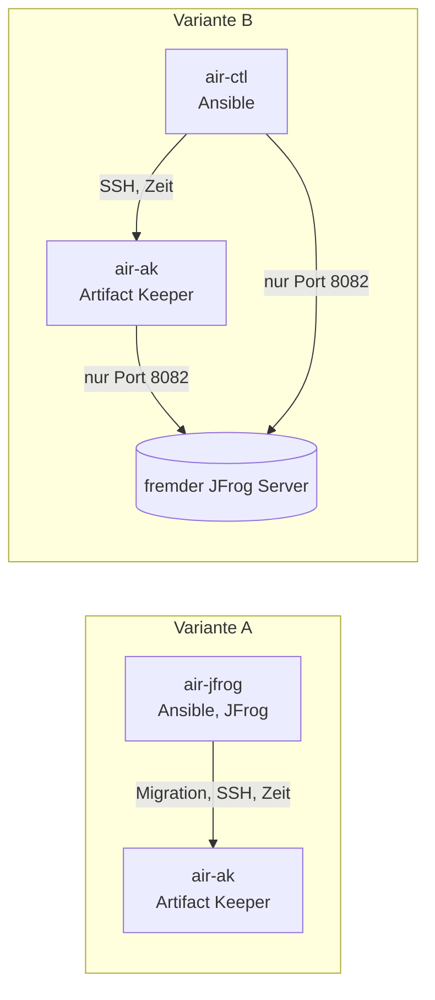

# 13 Testaufbau mit zwei VMs ohne Internet

[Zurück: Rechte und Identitäten](12-rechte-und-identitaeten.md) | [Übersicht](README.md) | [Weiter: JFrog Optimierung](14-jfrog-tuning.md)

Dieses Kapitel beschreibt einen vollständigen Testaufbau für eine restriktive Umgebung: Nur zwei VMs, keine Verbindung nach außen, alles automatisiert mit Ansible. Jeder Schritt ist hier so festgehalten, dass er sich ohne weitere Unterlagen wiederholen lässt. VirtualBox und PowerShell sind dafür nicht nötig.

## Die zwei Varianten

| | Variante A | Variante B |
|---|---|---|
| Wofür | Migration üben, wenn keine JFrog Instanz zur Verfügung steht | Migration gegen eine vorhandene JFrog Instanz prüfen |
| VM 1 | Ansible und JFrog (`air-jfrog`, 3 GB) | nur Ansible (`air-ctl`, 1,25 GB) |
| VM 2 | Artifact Keeper (`air-ak`, 4 GB) | Artifact Keeper (`air-ak`, 4 GB) |
| JFrog | Rolle `artifactory_oss`, Testdaten aus dem Bundle | fremder Server, nur Adresse und Konto bekannt |
| Inventory | `inventories/airgap-jfrog` | `inventories/airgap-external` |
| Bundle | 14 GB | 6,0 GB, ohne jede Datei von JFrog |



## Was restriktiv hier heißt

Die Rolle `restricted_host` setzt die Regeln und prüft sie. Jede lässt sich einzeln abschalten, falls das Unternehmen sie anders löst.

| Regel | Umsetzung | Prüfung |
|---|---|---|
| kein Weg nach außen | keine Default Route, kein DNS, Prüfung am Anfang jedes Laufs | Lauf bricht ab, wenn eine öffentliche Adresse erreichbar ist |
| Ausgang gesperrt, auch falls ein Gateway auftaucht | eigene `nftables` Tabelle `ak_egress`, zählt und protokolliert jedes Paket | Test mit vorübergehendem Gateway |
| Software nur vom Datenträger | Rolle `offline_repo`, alle anderen Quellen abgeschaltet | `dnf repolist` zeigt genau eine Quelle |
| Signaturen werden geprüft | `gpgcheck = 1` mit den Schlüsseln aus dem Bundle | |
| Datenträger schreibgeschützt und geprüft | Einhängen mit `-o ro`, `SHA256SUMS` | geänderte Datei wird erkannt |
| keine Programme aus temporären Verzeichnissen | `/tmp` und `/var/tmp` mit `noexec,nosuid,nodev` | Startversuch scheitert |
| strenge Dateirechte | `umask 0027` für sudo und Anmeldung, sudo Protokoll | ganzer Aufbau läuft damit |
| SELinux | `enforcing`, keine eigene Ausnahme | keine Ablehnungen seit dem Start |
| Dienste ohne Root | Podman rootless unter einem Konto ohne Anmeldung | wie im übrigen Projekt |
| Zeit ohne Internet | erste VM ist Zeitgeber, die zweite folgt ihr über `chrony` | `chronyc sources` |

## Schritt 1: Bundle außerhalb bauen

Das geschieht auf einem Rechner mit Internet und Rocky Linux oder RHEL 10 in derselben Minor Release wie die Ziel VMs.

```bash
sudo dnf -y install ansible-core git
git clone <dieses Repository> && cd <dieses Repository>/ansible
ansible-galaxy collection install -r requirements.yml -p collections
sudo mkdir -p /srv/ak-bundle && sudo chown "$USER" /srv/ak-bundle
```

Für Variante A, mit JFrog und Testdaten:

```bash
ansible-playbook -i localhost, -c local playbooks/bundle.yml -e bundle_profile=two_vm
```

Für Variante B, ohne JFrog:

```bash
ansible-playbook -i localhost, -c local playbooks/bundle.yml -e bundle_profile=two_vm -e bundle_jfrog=false
```

Im Test dauerte das 11 Minuten 27 Sekunden für Variante A beim ersten Mal und unter 3 Minuten für Variante B, mit bereits vorhandenen Images. Danach das Verzeichnis prüfen und auf den Datenträger kopieren:

```bash
cd /srv/ak-bundle && sha256sum -c SHA256SUMS
```

| Datei | Inhalt | Variante A | Variante B |
|---|---|---|---|
| `images/` | Images von Artifact Keeper | ja | ja |
| `images/` | Images von JCR, OSS und deren PostgreSQL | ja | nein |
| `seed/` | 24 Testimages und 5 Dateien, Manifeste unverändert | ja | nein |
| `rpms.tar`, `rpm-gpg/` | 15 Pakete mit allen Abhängigkeiten und Schlüsseln | ja | ja |
| `collections/`, `ansible-project.tar.gz` | Ansible Teile | ja | ja |
| `MANIFEST.yml`, `BUNDLE_ID`, `SHA256SUMS` | Nachweise | ja | ja |

**Wie der Transfer im Labor lief:** Das Bundle entstand auf einer eigenen virtuellen Platte der Bau VM. Die Platte wurde danach abgehängt und an die isolierte VM angeschlossen. Sie spielt also die Rolle eines USB Datenträgers, und zwischen beiden Seiten bestand nie eine Netzverbindung. Das Dateisystem trägt die Bezeichnung `AKBUNDLE`. Bei echtem USB ist nur das Gerät im nächsten Schritt anzupassen.

## Schritt 2: Zwei VMs installieren

| VM | RAM | vCPU | Platte | Adresse im Test |
|---|---|---:|---:|---|
| `air-jfrog` (nur Variante A) | 3 GB | 2 | 40 GB | 192.168.56.30 |
| `air-ctl` (nur Variante B) | 1,25 GB | 2 | 40 GB | 192.168.56.32 |
| `air-ak` | 4 GB | 2 | 40 GB | 192.168.56.31 |

1. Rocky Linux 10.2 von der Minimal ISO installieren. Die ISO enthält alles Nötige, ein Netz ist dabei nicht erforderlich.
2. Im Netzwerk eine einzige Karte ohne Gateway und ohne DNS vorsehen. In VirtualBox ist das **Host Only** oder **Internes Netzwerk**, nicht NAT.
3. Einen Benutzer `rocky` mit Administratorrechten anlegen.
4. Auf jeder VM an der Konsole die Adresse setzen und sudo ohne Passwort erlauben:

```bash
sudo nmcli con add type ethernet ifname "$(ip -o link | awk -F': ' '$2!="lo"{print $2; exit}')" con-name lab ipv4.method manual ipv4.addresses 192.168.56.31/24 ipv6.method disabled
sudo nmcli con up lab
echo 'rocky ALL=(ALL) NOPASSWD: ALL' | sudo tee /etc/sudoers.d/90-rocky
```

Den Datenträger nur an die erste VM anschließen. Im Labor erledigt das Anlegen `vm/create-airgap-lab.ps1`, das Bauen `vm/build-airgap-bundle.ps1` und das Zurücksetzen `vm/reset-airgap-vm.ps1`. Das sind Hilfen für den Windows Host und für die Lösung nicht erforderlich.

## Schritt 3: Steuerung einrichten

Auf der ersten VM, also `air-jfrog` oder `air-ctl`:

```bash
sudo mkdir -p /srv/ak-bundle
sudo mount -o ro LABEL=AKBUNDLE /srv/ak-bundle
tar -xzf /srv/ak-bundle/ansible-project.tar.gz -C ~
cd ~/ansible
bash tools/install-control-node.sh /srv/ak-bundle
ssh-keygen -q -t ed25519 -N '' -f ~/.ssh/id_ed25519
ssh-copy-id rocky@192.168.56.31
```

Das Skript prüft alle Prüfsummen und installiert `ansible-core` aus signierten Paketen, im Test in 11 bis 26 Sekunden.

Eigene Adressen stehen an zwei Stellen: `inventories/<Variante>/hosts.yml` für die VMs und `group_vars/all/main.yml` für das Netz und die Adresse von Artifact Keeper.

## Schritt 4: Variante A ausführen

```bash
cd ~/ansible
export ANSIBLE_VAULT_PASSWORD_FILE=~/.ansible/ak-vault-pass
python3 tools/generate-vault.py inventories/airgap-jfrog/group_vars/all/vault.yml
ansible-playbook -i inventories/airgap-jfrog/hosts.yml playbooks/airgap.yml
ansible-playbook -i inventories/airgap-jfrog/hosts.yml playbooks/jcr_seed.yml
```

Die erste Zeile nach `export` erzeugt die Zugangsdaten. Der JFrog Lizenzvertrag der JCR wird in diesem Inventory für die Laborinstanz angenommen (`artifactory_oss_accept_eula: true`). Das ist eine Entscheidung des Betreibers und vor dem Lauf zu prüfen. Artifactory OSS wählt man mit `-e artifactory_oss_edition=artifactory-oss`.

Danach die Migration mit allen Prüfungen:

```bash
bash tools/evidence/airgap-migration.sh inventories/airgap-jfrog ~/logs
ansible-playbook -i inventories/airgap-jfrog/hosts.yml playbooks/migrate.yml --tags verify_access
bash tools/evidence/airgap-check.sh inventories/airgap-jfrog 192.168.56.31
bash tools/evidence/airgap-reboot.sh 192.168.56.31 yes
```

## Schritt 5: Variante B ausführen

### Was der fremde Server liefern muss

| Voraussetzung | Hinweis |
|---|---|
| Adresse und Port | Eintrag `external_jfrog_host` und `external_jfrog_port` in `group_vars/all/main.yml` |
| Weg im Netz | von **beiden** VMs. Das Backend holt die Daten, die Steuerung prüft sie und liest die Rechte. |
| Konto | Für Daten genügen Leserechte auf alle Repositories. Für Benutzer, Gruppen und Rechte braucht es einen Administrator. |
| Liste der Repositories | Eintrag `artifactory_migration_repos` und `artifactory_migration_discover_docker_repos` |

Liegt der Server in einem anderen Netz, sind eine Route und der Eintrag in `restricted_host_egress_allow` nötig, alles andere bleibt gesperrt. Dieser Fall wurde mangels zweitem Netz nicht geprüft.

Das Playbook schreibt auf dem fremden Server nichts, geprüft über die Zahl der Dateien vor und nach dem Lauf. Es meldet sich an, liest Listen und lädt Daten herunter. Die Testdatenrolle ist in diesem Inventory nicht vorgesehen und `jcr_seed.yml` darf dort nicht laufen.

### Ablauf

```bash
cd ~/ansible
export ANSIBLE_VAULT_PASSWORD_FILE=~/.ansible/ak-vault-pass
python3 tools/generate-vault.py inventories/airgap-external/group_vars/all/vault.yml
ansible-vault edit inventories/airgap-external/group_vars/all/vault.yml
```

In der Datei `vault_external_jfrog_password` auf das Passwort des fremden Kontos setzen. Dann:

```bash
ansible-playbook -i inventories/airgap-external/hosts.yml playbooks/airgap.yml
bash tools/evidence/airgap-migration.sh inventories/airgap-external ~/logs
bash tools/evidence/airgap-check.sh inventories/airgap-external 192.168.56.31
```

Die zu vergleichenden Images liest `tasks/discover_images.yml` aus der Quelle, eine feste Liste gibt es hier nicht. Die Zugriffsmatrix `verify_access` läuft nicht, denn sie kennt nur die Testbenutzer. Eine eigene Matrix ist in `artifactory_migration_access_tests` einzutragen.

### Was ein fremder Server mit sich bringt

Drei Punkte zeigten sich erst in diesem Test und sind im Projekt berücksichtigt.

**Die Docker Katalog API verändert den Server.** Die naheliegende Abfrage `/v2/_catalog` und `/tags/list` lässt Artifactory interne Cachedateien anlegen, zum Beispiel `docker-base/.jfrog/repository_v2.catalog` und `docker-prod/.jfrog/web/caddy/tags.json`, Ersteller `_system_`. Im Test entstanden so 25 neue Dateien auf dem Server. Das Playbook fragt deshalb über AQL ab. Danach blieb die Quelle unverändert, 620 Dateien vorher und nachher.

**Solche Cachedateien lassen sich nicht migrieren.** Eine Instanz, die Clients über diese API abfragen, enthält sie vermutlich bereits. Sie stehen in der Liste der Quelle, ihr Download endet aber mit `Artifact not found`. Der Job endet mit `completed_with_errors`, ein Delta Lauf, der nur aus solchen Einträgen besteht, sogar mit `failed`. Die Daten kommen trotzdem vollständig an, im Test 27 von 27 Images. Das Playbook meldet diese Fehler getrennt und bricht nur bei echten Dateien ab. Der Ausschluss über `exclude_paths`, den Artifact Keeper anbietet, hat keine Wirkung: Im Test blieben alle 25 Fehler, und im Quelltext hat `should_exclude_path` außerhalb der Unit Tests keinen Aufrufer.

**Ein Konto mit wenig Rechten migriert still zu wenig.** Das Konto `rita` sieht nur einen Teil der Repositories. Der Job meldete `completed` mit 0 Fehlern, `helm-local` und `generic-tools` fehlten einfach. Das Playbook vergleicht jetzt die gewünschte Liste mit dem Sichtbaren und bricht ab: `The source does not list generic-tools, helm-local for account rita`. Wer das bewusst will, setzt `artifactory_migration_allow_invisible_repos`.

## Ergebnis Variante B

Beide VMs frisch, Bundle ohne JFrog, ein Lauf von `air-jfrog` als unverwalteter Quelle mit 24 Images aus Variante A und 3 Images aus deren Zugriffstests. Die Rohdaten liegen unter `lab/results/airgap/variante-b/`.

| Schritt | Ergebnis | Dauer |
|---|---|---:|
| `airgap.yml` | `failed=0`, Bundle enthält keine Datei von JFrog | 312 s |
| zweiter Lauf | `changed=0` | 23 s |
| Migration der Artefakte | 595 Einträge, 0 Fehler, 992 MB | 57 s |
| Dateien bitgenau | 6 von 6 | im selben Lauf |
| Images, aus der Quelle ermittelt | 27 von 27 mit gleichem Digest und vollständigem Download | |
| Gruppen und Rechte | 12 Regeln, wie in Variante A | 37 s |
| Quelle danach | unverändert, 620 Dateien vorher und nachher | |
| alle Prüfungen von `airgap-check.sh` | bestanden | |

| Fehlerfall | Verhalten |
|---|---|
| Konto ohne Rechte auf alle gewünschten Repositories | Abbruch mit klarer Meldung, siehe oben |
| dasselbe Konto mit `artifactory_migration_allow_invisible_repos` | migriert das Sichtbare |
| Benutzer und Rechte mit einem Konto ohne Administratorrechte | Abbruch, die Quelle antwortet mit 403 |
| falscher Port der Quelle | Abbruch beim Verbindungstest: `Connection failed: HTTP request failed` |
| Adresse nicht in `ak_standalone_ssrf_allow_private_cidrs` | HTTP 400 beim Anlegen der Verbindung, Meldung `Migration source URL IP ... is not allowed (private/internal network)` |

Speicher während der Migration: `air-ctl` 466 MB von 1186 MB, `air-ak` 1675 MB von 3634 MB. Platte der Steuerung: 2,5 GB ohne das Bundle.

## Ergebnis Variante A

Alle Läufe am 6. November 2026 aus dem fertigen Bundle, beide VMs vorher auf den frisch installierten Snapshot zurückgesetzt. Die Rohdaten liegen unter `lab/results/airgap/variante-a/`.

| Schritt | Ergebnis | Dauer |
|---|---|---:|
| Steuerung aus dem Bundle einrichten | erfolgreich, `ansible-core` 2.16.16, `ansible.posix` 2.2.2 | 26 s |
| `airgap.yml` auf frischen VMs | `failed=0` auf beiden VMs | 557 s |
| zweiter Lauf | `changed=0` auf beiden VMs | 30 s |
| Testdaten aus dem Bundle | 24 Images, 5 Dateien, 7 Gruppen, 22 Benutzer | 74 s |
| Migration der Artefakte | 583 Einträge, 0 Fehler, 990 MB | 56 s |
| Dateien bitgenau | 6 von 6 | im selben Lauf |
| Images, Digest und vollständiger Download | 24 von 24, auch Multi Arch | 40 s |
| Gruppen und Rechte | 7 Gruppen, 22 Benutzer, 12 Regeln | 37 s |
| Delta Lauf ohne Änderungen | `completed`, 0 Einträge | 4 s |
| Zugriffsmatrix als echte Benutzer | 13 von 14 gleich, die Abweichung ist das bekannte Pfadmuster aus [12](12-rechte-und-identitaeten.md) | 14 s |

Das Migrationsergebnis ist damit dasselbe wie im großen Labor mit Internet. Nach den letzten Änderungen am Code liefen Installation, Migration, beide Vergleiche und `airgap-check.sh` noch einmal mit 0 Fehlern, nun auch gegen eine Quelle mit `.jfrog` Dateien.

| Prüfung (`airgap-check.sh`) | Ergebnis |
|---|---|
| keine Default Route, 1.1.1.1 nicht erreichbar, `ghcr.io` nicht auflösbar, auf beiden VMs | bestanden |
| vorübergehendes Gateway: Host blockiert, jedes Paket gezählt und im Kernelprotokoll | bestanden |
| Programme aus `/tmp` und `/var/tmp` starten nicht | bestanden |
| SELinux `enforcing`, 0 Ablehnungen | bestanden |
| `gpgcheck = 1`, genau eine Paketquelle | bestanden |
| zweite VM folgt dem Zeitgeber (`^*`) | bestanden |
| Datenträger schreibgeschützt, Prüfsummen korrekt, geänderte Datei erkannt | bestanden |
| Lauf bricht ab, wenn ein Host nach außen kommt | bestanden, Meldung `Host reaches the outside` |

| Fehlerfall | Verhalten |
|---|---|
| Neustart der Artifact Keeper VM | nach 21 s bereit, ohne Eingriff. Mounts, Regeln und Zeitquelle bleiben erhalten, weiter keine Default Route. |
| Neustart der JFrog VM | REST API und Anmeldung nach 103 s Laufzeit des Systems, ohne Eingriff |
| Image fehlt | Start bricht sofort ab, kein Warten auf eine Registry. Ein Lauf des Playbooks stellt es in 13 s wieder her. |
| Container mit vorhandenem Gateway gestartet | `wget` scheitert, die Regel stoppt 5 Pakete |
| Pull über das Remote Repository `docker-hub` | Fehler nach 21 s. Lokale und virtuelle Repositories bleiben davon unberührt und antworten sofort. |
| Versuche von JFrog nach außen | siehe den nächsten Abschnitt |

## Was JFrog nach außen versucht

Ohne Route entsteht gar kein Paket, ein Zähler von 0 beweist also nichts. Die Messung braucht deshalb ein Gateway, das beim Start der Container schon besteht und ins Leere führt, und eine Gegenprobe aus dem Container.

```bash
bash tools/evidence/jfrog-outbound.sh 192.168.56.1 6
bash tools/evidence/jfrog-dns-names.sh 192.168.56.30 6
```

| Messung über 6 Minuten, JCR mit JFConnect aus | Ergebnis |
|---|---|
| vom Filter gestoppte Pakete | 96, ausschließlich DNS an 1.1.1.1 und 8.8.8.8, also an die alten Einträge in `/etc/resolv.conf` |
| Gegenprobe aus dem Container | 5 Pakete gezählt, der Filter sieht den Verkehr also |
| erfragte Namen | `localhost`, `_grpc_config.localhost`, `config.liquibase.com` |
| Adressen von JFrog wie `jes.jfrog.io` oder `releases.jfrog.io` | nicht erfragt |

`config.liquibase.com` gehört zur Datenbankbibliothek Liquibase in JFrog, nicht zu JFrog selbst. Der Dienst läuft auch ohne Antwort normal weiter. Die Messung umfasst nur die ersten 6 Minuten nach dem Start. Seltene Aufgaben, die nur täglich laufen, sieht sie nicht, und eine lizenzierte Edition mit JFConnect kann sich anders verhalten.

Der erste Versuch dieser Messung war ungültig und ist lehrreich: Solange ein Container des Netzes weiterläuft, behält das gemeinsame Containernetz seinen Zustand ohne Route. Er zeigte deshalb 0 Pakete, obwohl JFrog Anfragen stellte. Erst das vollständige Neustarten aller Container mit vorhandenem Gateway und die Gegenprobe machten die Messung aussagekräftig.

## Speicher und Platte

Speicher nach der Migration: `air-jfrog` 2356 MB von 2691 MB belegt und 331 MB im Swap, `air-ak` 1691 MB von 3634 MB, davon OpenSearch 918 MB und PostgreSQL 185 MB. Belegt auf der Platte: 8,9 GB und 7,0 GB.

## Was nur dieser Test gezeigt hat

| Befund | Bedeutung |
|---|---|
| Podman meldet `cannot chdir` | Das Dienstkonto darf das Heimverzeichnis des Aufrufers nicht betreten. Eigene Aufrufe mit `sudo -u ak` also aus `/` starten. |
| Eine VM mit 3 GB meldet 2691 MB | Der Kernel reserviert den Rest. Grenzwerte im Inventory sind darauf abgestimmt. |
| Rootless Podman ohne Default Route | Funktioniert. Das Backend erreicht die andere VM ohne Zusatzeinstellung. |
| Container hat ohne Gateway keinen Weg nach außen | Das gilt schon vor der Regel. Die Regel stoppt Pakete erst, wenn beim Start des Containers ein Gateway existiert. Beides wurde getrennt geprüft. |
| Reste in `/etc/resolv.conf` | Einträge aus einer früheren Netzkonfiguration schaden nicht, weil keine Route zu ihnen führt. |
| Der Zeitgeber folgt keiner Quelle | Beide VMs sind untereinander genau, können aber gemeinsam von der echten Zeit abweichen. Im Labor betrug das nach einer Pause der VMs etwa 14 Minuten. Für Produktion sind interne Zeitserver einzutragen. |
| Volle Host Platte | VirtualBox pausiert die VMs ohne Datenverlust. Für das Labor mindestens 60 GB frei einplanen. |
| Zeilenenden | Wird ein Passwort über eine PowerShell Pipeline kopiert, hängt ein Zeilenende daran, und JFrog antwortet mit 401. Das Passwort daher von Hand in die Vault Datei eintragen. |
| Fehlendes skopeo | Der Vergleich der Images meldete zunächst überall BROKEN, weil das Paket nur beim Laden der Testdaten installiert wurde. Die Rolle installiert es nun auch für den Vergleich. |

## Grenzen

Nicht geprüft wurden:

* eine lizenzierte JFrog Instanz als fremder Server
* ein fremder Server in einem anderen Netz mit Route und Eintrag in `restricted_host_egress_allow`
* sudo mit Passwort, also `-K`. Geprüft wurde nur `NOPASSWD`.
* FIPS Modus des Betriebssystems und CIS Profile in voller Breite
* echte Hardware und andere Hypervisoren
* Internes Netzwerk von VirtualBox. Getestet wurde Host Only ohne Gateway, was für die VMs keinen Unterschied macht.
* HTTPS. Der Aufbau spricht HTTP und ist nur für Tests gedacht. Ein Produktivsystem braucht TLS, ein internes Zertifikat und `AK_EXTERNAL_URL` mit `https`.
* Betrieb im größeren Maßstab. Zwei VMs bieten keine Hochverfügbarkeit, dafür gilt [Kapitel 11](11-nat-netzwerk.md).
