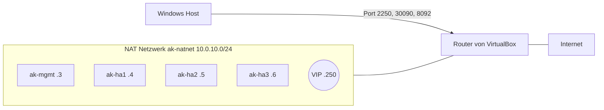

# 2 Netzwerk

[Zurück: Worum es geht](01-artefakt-repository.md) | [Übersicht Grundlagen](README.md) | [Weiter: Hochverfügbarkeit](03-hochverfuegbarkeit.md)

## IP Adresse und Subnetz

Jede Maschine im Netz hat eine **IP Adresse**, zum Beispiel `10.0.10.4`. Ein **Subnetz** ist ein Bereich zusammengehöriger Adressen. Die Schreibweise `10.0.10.0/24` bedeutet: Die ersten 24 Bit sind fest, also gehören alle Adressen von `10.0.10.0` bis `10.0.10.255` dazu. Maschinen im selben Subnetz erreichen sich direkt, für alles andere fragen sie das **Gateway**, den Weg nach draußen.

## DHCP und feste Adressen

**DHCP** ist ein Dienst, der neuen Maschinen automatisch eine Adresse zuteilt. Das ist bequem, aber die Zuteilung (Lease) kann sich ändern. Ein Cluster kann das nicht verkraften, weil seine Mitglieder einander über feste Adressen finden. Deshalb übernimmt `playbooks/bootstrap.yml` die vom DHCP erhaltene Adresse und trägt sie fest ein.

## NAT

**NAT** (Network Address Translation) übersetzt Adressen. Ein Heimrouter macht das täglich: Alle Geräte teilen sich nach außen eine Adresse. Antworten aus dem Internet finden über eine Tabelle zurück zum richtigen Gerät. Von außen lässt sich dabei keine Verbindung zu einem Gerät aufbauen, solange niemand das ausdrücklich erlaubt.

## NAT oder NAT Netzwerk in VirtualBox

Hier liegt eine beliebte Falle. VirtualBox hat zwei Varianten mit fast gleichem Namen:

| Variante | Verhalten | Eignung für den Cluster |
|---|---|---|
| NAT | Jede VM bekommt ihr eigenes, abgeschottetes Netz. Sie erreicht das Internet, aber keine andere VM. | ungeeignet |
| NAT Netzwerk | Alle VMs teilen ein gemeinsames Netz, erreichen einander und das Internet. | passend |

Andere VirtualBox Modi wie Bridged oder Host Only werden nicht gebraucht, so bleibt der Aufbau auf jedem Rechner gleich.

## Portweiterleitung

Weil von außen niemand in das NAT Netz hineinkommt, erreicht auch der eigene Rechner die VMs nicht von selbst. Eine **Portweiterleitung** ist die Ausnahme: Was am Host auf einem bestimmten Port ankommt, geht an eine bestimmte Adresse im Netz.

| Host | Ziel im NAT Netzwerk | Zweck |
|---|---|---|
| `127.0.0.1:2250` | Management VM, Port 22 | Anmeldung per SSH |
| `127.0.0.1:30090` | VIP, Port 80 | Oberfläche und Registry von Artifact Keeper |
| `127.0.0.1:8092` | `ak-ha3`, Port 8082 | Oberfläche der Quelle |

Ein **Port** ist eine Art Türnummer an einer Adresse, damit mehrere Dienste auf einer Maschine laufen können. Auf Port 22 antwortet SSH, auf 80 HTTP.

Die Weiterleitung auf die VIP hat im Test eine Folge sichtbar gemacht: Die Adresse `localhost:30090` existiert nur auf dem Host. Kommt ein Registry Client von einer VM, kennt er diese Adresse nicht und kann kein Token holen. In Produktion löst das ein **DNS Name**, also ein Name wie `artifacts.firma.example`, den alle gleich auflösen.

## Netzwerksegmentierung

**Segmentierung** teilt ein Netz in Bereiche mit kontrollierten Übergängen. Der Gedanke: Wird ein Rechner übernommen, soll nicht das ganze Unternehmen offenliegen. Das Labor nutzt aus Einfachheit nur ein Netz. In Produktion wäre eine Trennung sinnvoll:

| Segment | Inhalt | Wer darf hinein |
|---|---|---|
| Client | Zugang über die VIP | Entwickler und Pipelines |
| Cluster | Datenbank, etcd, Garage, OpenSearch | nur die Knoten selbst |
| Verwaltung | SSH, Ansible, Überwachung | nur die Administration |

## Firewall

Eine **Firewall** entscheidet je Port, was hereindarf. Rocky Linux nutzt `firewalld` mit Zonen. Die Rolle `base` legt die Zone `ak-cluster` an, in der die Clusterports nur im Clusternetz offen sind. Im frühen Test sperrte sich Ansible damit selbst aus: Die Zone galt auch für die eigene SSH Verbindung, und SSH war dort nicht erlaubt. Seither wird SSH freigegeben, bevor das Netz an die Zone gebunden wird. Solche Fehler stehen in [Kapitel 08](../08-ansible.md).

## SSH

**SSH** ist die verschlüsselte Fernanmeldung an einem Linux System. Ansible arbeitet darüber. Statt eines Passworts nutzt es ein Schlüsselpaar: Der öffentliche Teil liegt auf dem Zielrechner, der private bleibt auf der Management VM. `tools/copy-ssh-keys.sh` verteilt ihn.
