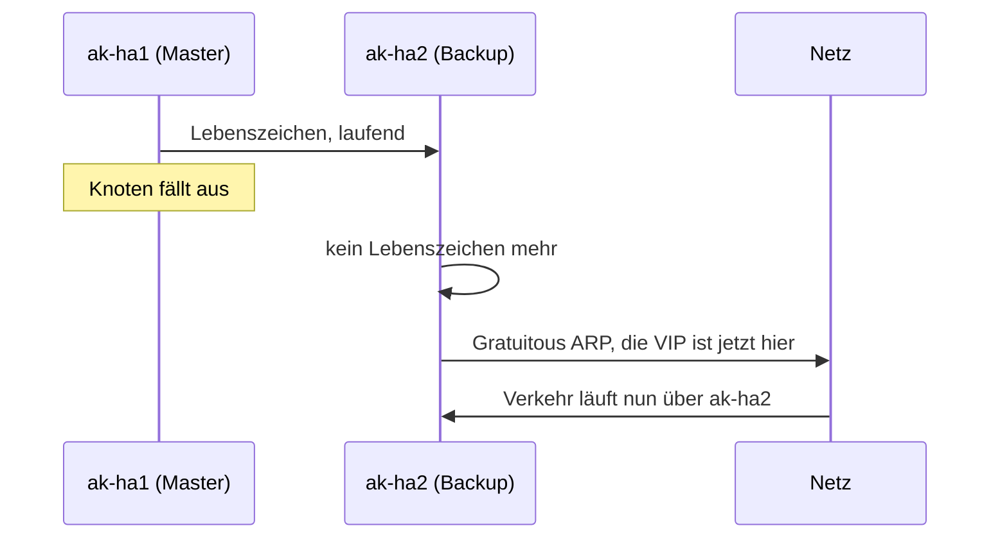

# 3 Hochverfügbarkeit

[Zurück: Netzwerk](02-netzwerk.md) | [Übersicht Grundlagen](README.md) | [Weiter: Datendienste](04-datendienste.md)

## Das Problem

Läuft ein Dienst auf einem Rechner und fällt dieser aus, steht der Dienst. Fällt die Registry aus, stehen alle Builds. **Hochverfügbarkeit** bedeutet: Der Dienst überlebt den Ausfall einzelner Teile, möglichst ohne dass jemand eingreifen muss. Eine Stelle, deren Ausfall alles lahmlegt, heißt **Single Point of Failure**. Der ganze Aufbau dient dazu, solche Stellen zu beseitigen.

Hochverfügbarkeit heißt nicht, dass nichts zu merken ist. Im Test dauerte die Unterbrechung beim harten Ausfall des Knotens mit der Datenbank etwa 36 bis 44 Sekunden. Sie heißt auch nicht Datensicherung: Löscht jemand ein Artefakt, ist es sofort auf allen Knoten weg. Ein Backup bleibt nötig.

## Aktiv/aktiv und aktiv/passiv

| Betriebsart | Bedeutung | Im Aufbau |
|---|---|---|
| aktiv/aktiv | Alle arbeiten gleichzeitig. Fällt einer aus, tragen die anderen die Last. | Artifact Keeper, Garage, OpenSearch |
| aktiv/passiv | Einer arbeitet, ein anderer steht bereit. | VIP und PostgreSQL |

## Quorum: Warum drei Knoten?

Stellen wir uns zwei Knoten vor, deren Netzverbindung reißt. Jeder sieht den anderen nicht mehr und kann nicht unterscheiden, ob dieser tot oder nur unerreichbar ist. Arbeiten beide weiter und schreiben in ihre eigene Datenbank, entstehen zwei widersprüchliche Wahrheiten. Das heißt **Split Brain** und ist schlimmer als ein Ausfall.

Die Lösung ist eine Abstimmung. Nur eine Mehrheit, das **Quorum**, darf entscheiden.

| Knoten | nötige Mehrheit | verkraftbare Ausfälle |
|---|---|---|
| 2 | 2 | 0, also nicht besser als einer |
| 3 | 2 | 1 |
| 5 | 3 | 2 |

Bei einer Trennung kann immer höchstens eine Seite die Mehrheit haben. Darum braucht das System drei Knoten. Der dritte Knoten `ak-ha3` führt im Labor keine Anwendung aus und liefert hauptsächlich die dritte Stimme für etcd, Garage und OpenSearch.

## Die virtuelle IP (VIP)

Clients brauchen eine Adresse. Zeigt sie auf `ak-ha1` und fällt dieser aus, müssten alle Clients umgestellt werden. Die Lösung ist eine **virtuelle IP**: eine Adresse, die keinem Rechner fest gehört und im Fehlerfall zu einem anderen wandert. Im Labor ist das `10.0.10.250`.

## ARP: Wie das Netz die VIP findet

Im lokalen Netz werden Daten nicht an IP Adressen, sondern an Hardwareadressen (MAC) der Netzwerkkarten geschickt. **ARP** ist die Frage in die Runde: „Wer hat 10.0.10.250?“ Wer sie hat, antwortet mit seiner MAC Adresse, und die anderen merken sich das kurz.

Übernimmt ein neuer Knoten die VIP, sendet er unaufgefordert eine solche Antwort, ein **Gratuitous ARP**. Damit weiß das Netz sofort, wohin die Daten nun müssen.

## VRRP und keepalived

**VRRP** (Virtual Router Redundancy Protocol) regelt, wer die VIP hält. Der aktuelle Inhaber, der Master, sendet laufend ein Lebenszeichen. Bleibt es aus, übernimmt der Knoten mit der nächsthöheren Priorität.

**keepalived** ist das Programm, das VRRP umsetzt. Die wichtigsten Einstellungen im Projekt, zu finden in `roles/keepalived`:

| Einstellung | Bedeutung | Warum so |
|---|---|---|
| `unicast` | Lebenszeichen gehen direkt an den anderen Knoten statt an alle | Multicast funktioniert in vielen virtuellen Netzen und Clouds nicht. |
| `keepalived_priority` | Rang des Knotens: 150 bei ak-ha1, 100 bei ak-ha2 | bestimmt den ersten Inhaber |
| `nopreempt` | Ein zurückgekehrter Knoten holt sich die VIP nicht zurück. | Sonst gäbe es eine zweite, unnötige Unterbrechung. |
| `track_process haproxy` | Stirbt HAProxy, gibt der Knoten die VIP ab. | Eine VIP auf einem Rechner ohne Dienst nützt nichts. |
| `arping` Prüfung | Vor dem Start wird geprüft, ob die Adresse schon belegt ist. | Im ersten Labor kollidierte die VIP mit dem DHCP Server von VirtualBox. |

## HAProxy: Der Verteiler

keepalived bringt die Anfrage auf einen Knoten, **HAProxy** verteilt sie an funktionierende Dienste. Ein solches Programm heißt Load Balancer. Es prüft jeden Dienst regelmäßig und nimmt defekte aus der Verteilung.

| HAProxy Port | Ziel | Prüfung |
|---|---|---|
| 80 | Backend und Web von Artifact Keeper | `/readyz` und `/` |
| 5000 | PostgreSQL, nur der aktuelle Primary | Patroni `/primary` |
| 3910 | Garage S3 | `/health` |
| 9201 | OpenSearch | `/_cluster/health` |

Die Anwendung spricht ihre Datenbank über `localhost:5000` an und muss nicht wissen, welcher Knoten gerade Primary ist. Das vereinfacht den Aufbau erheblich.

**Drain** ist ein geordnetes Herausnehmen: HAProxy schickt keine neuen Anfragen mehr an einen Knoten, laufende dürfen fertig werden. Das Testprotokoll zeigt den Wert: Ein Neustart ohne Drain ergab 2 Fehler von 681 Anfragen, mit Drain keinen. Die Handler der Rolle `artifact_keeper` machen das bei jedem Update automatisch.

## Was bei einem Ausfall passiert

Der schwerste Fall ist der harte Ausfall von `ak-ha1`, wenn er die VIP und den PostgreSQL Primary hält:

1. keepalived auf `ak-ha2` vermisst das Lebenszeichen und übernimmt die VIP. Das dauert wenige Sekunden.
2. Patroni auf `ak-ha2` wartet, bis die Führung in etcd abläuft (TTL). In dieser Zeit antwortet die Anwendung mit Fehlern. Das ist der größte Teil der Unterbrechung.
3. Patroni macht die Replica zum Primary, HAProxy erkennt das an `/primary`.
4. Artifact Keeper arbeitet wieder. Garage und OpenSearch laufen mit zwei von drei Stimmen weiter.
5. Kommt `ak-ha1` zurück, wird er Replica. Die VIP bleibt dank `nopreempt` auf `ak-ha2`.

Niemand muss eingreifen. Die Messwerte stehen im [Testprotokoll](../05-testprotokoll.md).
