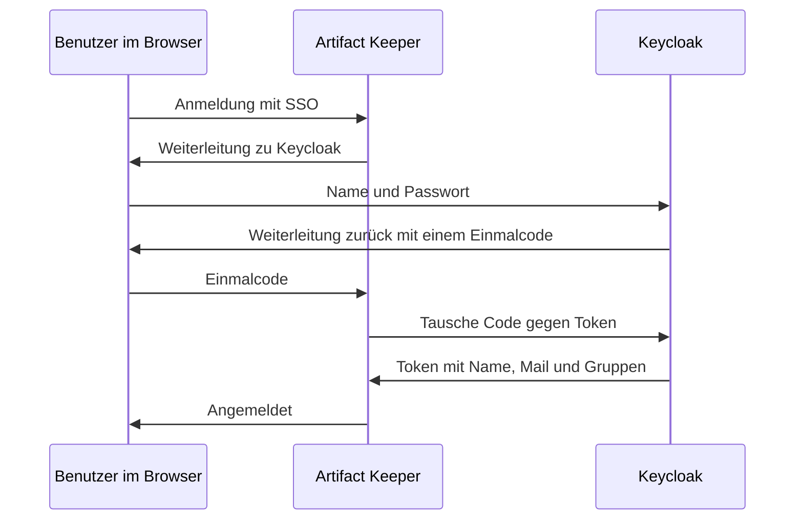

# 6 Benutzer, Rechte und Identitätsanbieter

[Zurück: Container](05-container.md) | [Übersicht Grundlagen](README.md) | [Weiter: Ansible](07-ansible.md)

## Drei Fragen

Jeder Zugriff beantwortet drei Fragen:

1. **Wer bist du?** Das ist die Authentifizierung, etwa per Passwort.
2. **Zu welchen Gruppen gehörst du?** Rechte werden an Gruppen vergeben, nicht an einzelne Personen. Wer das Team wechselt, wechselt nur die Gruppe.
3. **Was darf diese Gruppe?** Das ist die Autorisierung, also die eigentlichen Rechte.

## Rechte in beiden Produkten

**Artifactory** arbeitet mit Permission Targets. Ein Target sagt zum Beispiel: Die Gruppe `team-checkout` darf im Repository `docker-prod` lesen, außer unter `data/**`. Das Muster ist sehr fein.

**Artifact Keeper** arbeitet mit Regeln: eine Gruppe, ein Repository, eine Liste von Aktionen. Pfade kennt es nicht. Wer feiner trennen will, teilt die Inhalte in mehrere Repositories auf.

Die vollständige Gegenüberstellung steht in [Kapitel 12](../12-rechte-und-identitaeten.md).

## Identitätsanbieter

Hält jedes Programm eigene Benutzer, muss beim Austritt eines Mitarbeiters jedes einzeln bereinigt werden. Ein **Identitätsanbieter** (IdP) ist der eine Ort, an dem Benutzer und Gruppen gepflegt werden, die anderen Programme fragen ihn. Bekannte Beispiele sind Keycloak, Microsoft Entra ID und Okta. **Single Sign On** bedeutet, dass die Anmeldung beim IdP für alle angeschlossenen Programme gilt.

**Keycloak** ist ein Open Source IdP. Ein **Realm** ist darin ein abgeschlossener Bereich mit eigenen Benutzern und Gruppen, ein **Client** eine angeschlossene Anwendung, hier Artifact Keeper.

## OpenID Connect

**OpenID Connect** (OIDC) ist das Protokoll, in dem Anwendung und IdP miteinander reden. Vereinfacht läuft die Anmeldung so:

Wichtig ist: Artifact Keeper sieht das Passwort nie. Es erhält nur ein unterschriebenes **Token**, in dem Angaben, die sogenannten **Claims**, stehen. Der Claim `groups` nennt die Gruppen. Der **Issuer** ist die Adresse des Ausstellers, die für Anwendung und Browser identisch sein muss.

Jeder Benutzer hat beim IdP eine feste Kennung, `sub`. Artifact Keeper erkennt ihn daran und nicht am Namen.

## Warum die Reihenfolge wichtig ist

Dieser Punkt überrascht am meisten und wurde getestet.

| Situation | Ergebnis |
|---|---|
| Es gibt ein lokales Konto `dora`, und `dora` meldet sich über Keycloak an. | Abgelehnt mit HTTP 409, weil der Name vergeben ist. Die Kennung `sub` kennt das System noch nicht, und eine Verknüpfung ist nicht vorgesehen. |
| Es gibt eine lokale Gruppe `team-data`, und Keycloak meldet `team-data`. | Die Mitgliedschaft wird verweigert. Sonst könnte jemand über einen Gruppennamen im Verzeichnis in eine privilegierte lokale Gruppe gelangen. Das ist eine bewusste Schutzmaßnahme. |

Also gilt: Sollen Personen aus dem Verzeichnis kommen, werden sie nicht vorher lokal angelegt. Gruppen entstehen bei der ersten Anmeldung, danach werden die Rechte daran gehängt.

## Tokens für Maschinen

Ein Docker Client kann keine Browseranmeldung durchführen, und Konten aus dem IdP haben kein Passwort. Deshalb gibt es **API Tokens**: lange Zufallswerte, die wie ein Passwort benutzt werden und per **Scope** beschränkt sind, zum Beispiel `read:artifacts`. Der Test zeigte zwei Dinge:

* Fehlt der Scope, lautet die Meldung `Token does not have required scope`. Der Scope begrenzt das Token zusätzlich zu den Rechten des Benutzers.
* Wird jemand beim IdP aus einer Gruppe entfernt, ändert das zunächst nichts. Der Abgleich läuft erst bei der nächsten Anmeldung. Bis dahin funktioniert das Token weiter. Beim Austritt eines Mitarbeiters ist das Konto daher auch in Artifact Keeper zu deaktivieren.

Pipelines nutzen in der Regel lokale technische Konten mit eigenen Tokens. Ist ein Identitätsanbieter aktiv, können sich lokale Konten nicht mehr anmelden. Ihr Token stellt daher ein Administrator aus.
