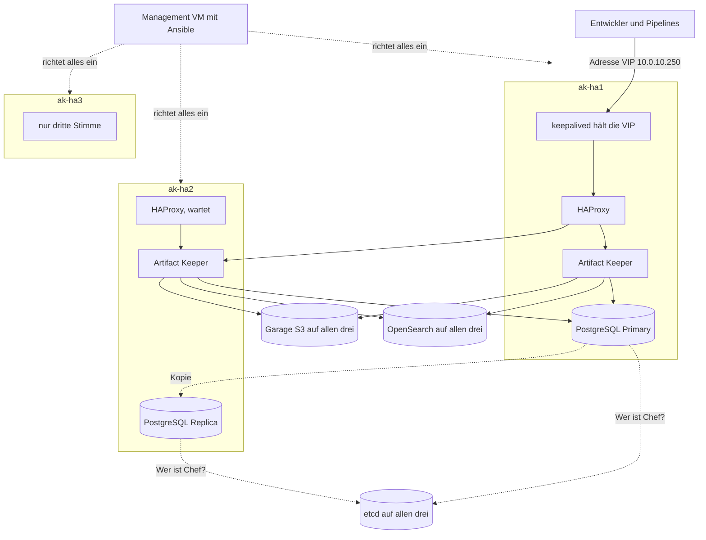

# Grundlagen

[Zurück zur Übersicht](../README.md)

Dieser Ordner richtet sich an alle, die die Technik hinter dieser Evaluierung noch nicht kennen. Vorwissen über Netzwerke oder Cluster ist nicht nötig. Jeder Begriff wird dort erklärt, wo er zuerst gebraucht wird, und immer am Beispiel des tatsächlichen Aufbaus.

## Lesereihenfolge

| Kapitel | Inhalt | Beantwortet |
|---|---|---|
| [1 Worum es geht](01-artefakt-repository.md) | Artefakt Repository, Registry, Tags und Digests, Artifactory und Artifact Keeper | Was ist das, und warum wollen wir wechseln? |
| [2 Netzwerk](02-netzwerk.md) | IP Adresse, Subnetz, DHCP, NAT, NAT Netzwerk, Portweiterleitung, Segmentierung, Firewall | Wie reden die Maschinen miteinander? |
| [3 Hochverfügbarkeit](03-hochverfuegbarkeit.md) | Ausfall, Quorum, VIP, ARP, VRRP, keepalived, HAProxy | Was passiert, wenn ein Rechner stirbt? |
| [4 Datendienste](04-datendienste.md) | PostgreSQL, Patroni, etcd, S3, Garage, OpenSearch | Wo liegen die Daten, und warum so viele Dienste? |
| [5 Container](05-container.md) | Container, Podman, rootless, Quadlet, systemd, SELinux | Wie laufen die Programme? |
| [6 Benutzer und Rechte](06-identitaeten.md) | Benutzer, Gruppen, Rechte, Identitätsanbieter, OpenID Connect, Keycloak, Tokens | Wer darf was, und woher weiß das System das? |
| [7 Ansible](07-ansible.md) | Inventory, Playbook, Rolle, Vault, alle Skripte dieses Projekts | Wie wird das alles aufgebaut? |
| [8 Anpassen](08-anpassen.md) | Häufige Änderungen mit Fundstelle | Was stelle ich wo um? |

## Das Gesamtbild

Das Bild wirkt zunächst groß. Die Idee ist einfach: **Jede Aufgabe läuft mehrfach, und für jede Aufgabe gibt es einen Mechanismus, der einen Ausfall erkennt und umschaltet.** Die folgenden Kapitel gehen diese Aufgaben einzeln durch.
